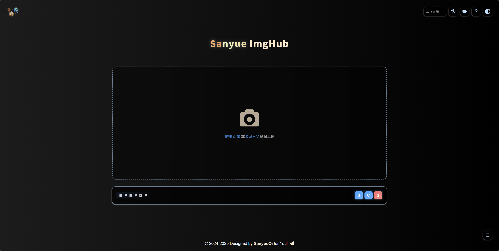
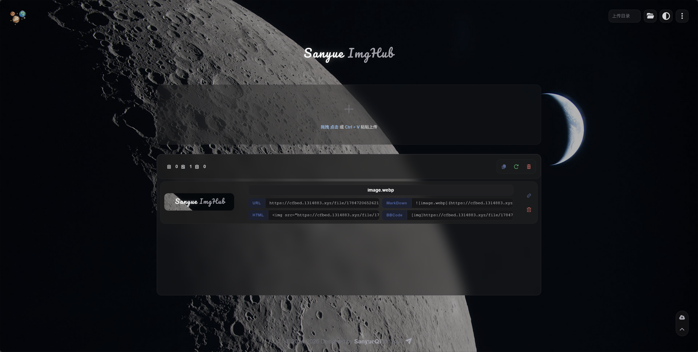
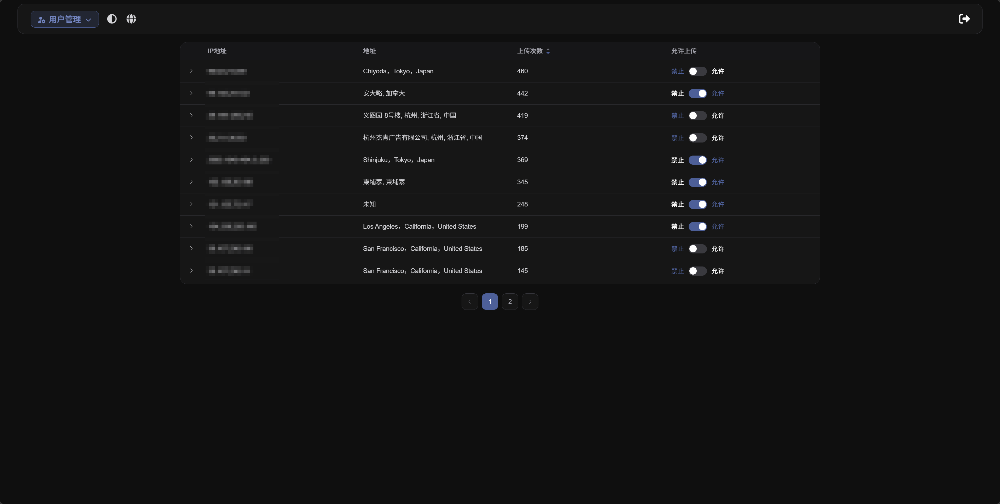
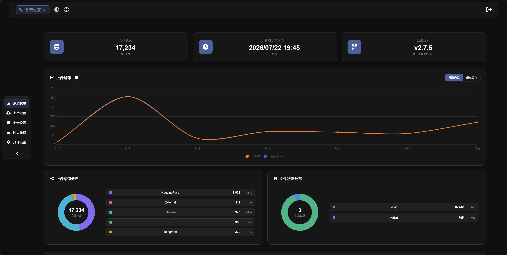

<div align="center">
    <p><em>🗂️ AnimeLK Storage — beyond image hosting: an all-in-one, open-source file management hub.</em></p>
    <p>
        <a href="https://github.com/Akila-Widuruwan/mystorage">GitHub</a>
    </p>
    <p>
        <a href="https://github.com/Akila-Widuruwan/mystorage/blob/main/LICENSE"></a>
        <a href="https://github.com/MarSeventh/CloudFlare-ImgBed/releases"></a>
    </p>
</div>

---

# 1. 💡 Introduction

**AnimeLK Storage** is a self-hosted image and file hosting solution for Docker and serverless (Cloudflare) environments, bringing **Telegram**, **Discord**, **Cloudflare R2**, **S3-compatible storage**, **Hugging Face**, **WebDAV**, and more into one management interface.

It provides file management, authentication, directory organization, content moderation, a RESTful API, and WebDAV, with a growing range of personalized AI capabilities such as image tag recognition. It is suited to personal image hosting, website asset management, and lightweight file distribution.



<details>
    <summary>More screenshots</summary>

<table>
  <tr>
    <td align="center" width="50%">
      <strong>Login Page</strong><br>
      
    </td>
    <td align="center" width="50%">
      <strong>Upload Progress</strong><br>
      
    </td>
  </tr>
  <tr>
    <td align="center" width="50%">
      <strong>File Management</strong><br>
      
    </td>
    <td align="center" width="50%">
      <strong>User Management</strong><br>
      
    </td>
  </tr>
  <tr>
    <td align="center" width="50%">
      <strong>Status Page</strong><br>
      
    </td>
    <td align="center" width="50%">
      <strong>Public Gallery</strong><br>
      
    </td>
  </tr>
</table>

</details>

# 2. ✨ Features

- **Multi-backend storage**: Telegram, Discord, Cloudflare R2, S3-compatible services, Hugging Face, WebDAV, and local server storage — all manageable from one dashboard.
- **File management**: browse, search, organize into directories, preview, and moderate content.
- **Authentication & user management**: admin panel, API tokens, and per-user quotas.
- **RESTful API & WebDAV**: integrate uploads and downloads into any workflow.
- **AI capabilities**: image tag recognition and other smart helpers.
- **Serverless or self-hosted**: runs on Cloudflare Pages/Workers or via Docker/Node.js.

# 3. 🚀 Deployment

## Cloudflare (Pages / Workers)

1. Fork this repository.
2. Follow the upstream deployment guide for Cloudflare Pages or Workers: **[Deployment docs →](https://cfbed.sanyue.de/en/guide/deploy/pages-deploy.html)**
3. For Workers, configure your bindings (D1/KV, R2) in `deploy/worker/wrangler.toml` and run:

   ```bash
   npm install
   npm run deploy:worker
   ```

## Docker

```bash
git clone https://github.com/Akila-Widuruwan/mystorage.git
cd mystorage
docker compose up -d
```

The service listens on port **7658** (mapped to the container's 8080). Data is persisted in the local `./data` directory.

You can also build the image yourself with the included `Dockerfile`.

## Node.js server

```bash
npm install
npm run start:docker   # runs the Node server (deploy/server)
```

For development on Cloudflare's runtime:

```bash
npm install
npm start              # wrangler pages dev on http://localhost:8080
```

# 4. 📦 Large file uploads (20 MB – 2 GB)

AnimeLK Storage supports files from small images up to **2 GB and beyond** through automatic **chunked uploads**: any file larger than 16 MB is split into 16 MB chunks (each well under Cloudflare's 100 MB per-request body limit), uploaded one by one, and merged at the destination using native multipart uploads (R2/S3) or on-the-fly reassembly when serving (Telegram).

## Which channel can handle 20 MB – 2 GB on a free setup?

| Storage channel | Files 20 MB – 2 GB | Free-tier notes |
| --- | --- | --- |
| **Cloudflare R2** | ✅ Yes (up to ~5 TB per file) | Best free option: 10 GB free storage/month, 1M writes, 10M reads, free egress. A 2 GB file ≈ 125 chunk writes — trivially within free limits. Holds ~5 files of 2 GB. |
| **S3-compatible** | ✅ Yes | Works with any free-tier S3 provider (e.g. Backblaze B2's 10 GB free). Multipart merge supported. |
| **Telegram** | ⚠️ Up to ~800 MB free | Uploads are free and unlimited (chunks stored as Telegram documents). Serving streams chunks in one request, and the Workers free plan allows only 50 external subrequests per request — a 2 GB file needs ~125 chunk fetches. Use R2/S3 for 2 GB files on the free plan, or Workers Paid. |
| **Discord** | ❌ 10 MB (25 MB with Nitro) | Hard per-file cap of the Discord API. |
| **WebDAV / Hugging Face** | ❌ Over ~100 MB | No chunk support; limited by the platform request body limit (100 MB on Cloudflare free). |

> [!TIP]
> On Cloudflare's free plan, set **Cloudflare R2** as your upload channel for large files. R2 multipart uploads from Workers are not capped by the 100 MB request body limit because each chunk travels as its own request.

## Fully self-hosted (no Cloudflare limits)

Running the Docker/Node server (`docker compose up -d`) uses **local disk storage** with no request-body limits at all — 2 GB+ files work out of the box, limited only by your disk space. This is completely free software; run it on your own hardware or any free-tier VPS.

References: [Cloudflare Workers limits](https://developers.cloudflare.com/workers/platform/limits/) · [Cloudflare R2 pricing](https://developers.cloudflare.com/r2/pricing/)

# 5. 📚 Documentation

The upstream documentation covers deployment, storage backend configuration, feature usage, RESTful API integration, WebDAV, version upgrades, and troubleshooting:

**[Read the full documentation →](https://cfbed.sanyue.de/en)**

# 6. ⚖️ License & Credits

> [!IMPORTANT]
> This project is licensed under the [MIT License](LICENSE). You may use, modify, and distribute it, provided that the original copyright and license notices are retained in all copies or substantial portions of the software.

AnimeLK Storage is a rebranded fork of the open-source project **[CloudFlare ImgBed](https://github.com/MarSeventh/CloudFlare-ImgBed)** by [MarSeventh](https://github.com/MarSeventh), which evolved from [Telegraph-Image](https://github.com/cf-pages/Telegraph-Image). All credit for the original implementation goes to its authors and contributors.

Related upstream projects:

- **Web frontend**: [MarSeventh/Sanyue-ImgHub](https://github.com/MarSeventh/Sanyue-ImgHub)
- **Desktop client**: [MarSeventh/satellite](https://github.com/MarSeventh/satellite)
